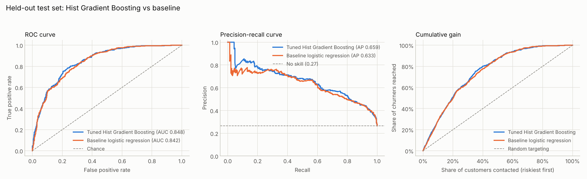
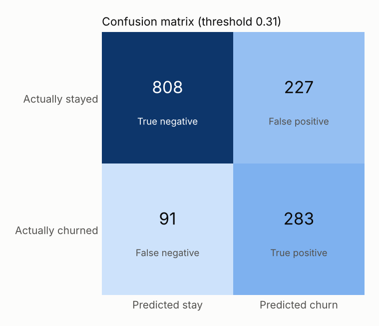
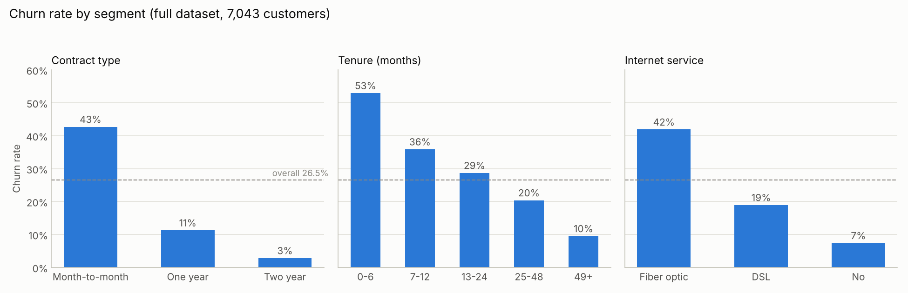
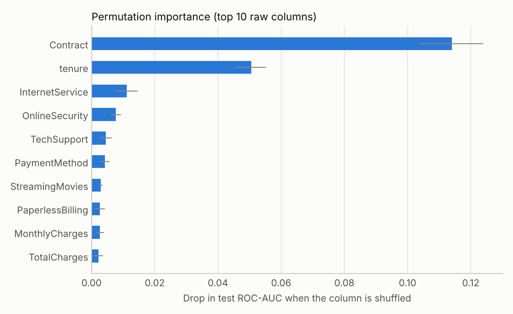

# Telco Customer Churn Prediction

Predict which telecom customers are about to leave, so a retention team can
contact the right people first. End-to-end scikit-learn project: data cleaning,
feature engineering, model comparison with cross-validation, hyperparameter
tuning, threshold selection, held-out evaluation, and error analysis.

**Headline result (held-out test set, 1,409 customers, 26.5% churn):**
ROC-AUC **0.848** (95% CI 0.827 to 0.869) and PR-AUC **0.659**. Contacting the
riskiest 20% of customers reaches **51%** of all churners (2.5x better than random).



## Data

IBM Telco Customer Churn sample dataset (7,043 customers, 19 features such as
contract type, tenure, services subscribed, monthly charges; target = `Churn`).
A copy is in `data/`; original source:
<https://github.com/IBM/telco-customer-churn-on-icp4d>.

Cleaning decisions (all in `load_data()`):
- `TotalCharges` is stored as text and 11 rows are blank. All 11 have `tenure = 0`
  (customers not yet billed), so they are filled with 0. The code asserts this.
- `customerID` is dropped (no signal, invites leakage).
- No duplicates or other missing values.

## Method

| Step | What was done |
|---|---|
| Split | 80/20 stratified train/test (seed 42). The test set is used only for reporting, never for choosing anything. |
| Features | 5 engineered features (add-on service count, average monthly spend, price vs. history, autopay flag, tenure bucket) computed inside the sklearn pipeline, so the saved model scores raw customer rows. |
| Models | Dummy baseline, Logistic Regression, Random Forest, Hist Gradient Boosting. |
| Validation | 5-fold stratified CV on the training set. |
| Tuning | Grid/randomized search optimizing PR-AUC (the churn class is the minority, so PR-AUC is more informative than accuracy). |
| Selection | Winner picked by CV score only. |
| Threshold | Chosen to maximize F1 on **out-of-fold training predictions** (0.31), then applied unchanged to the test set. |
| Uncertainty | 1,000-sample bootstrap confidence intervals on the test metrics. |

## Results

**Cross-validation on the training set (default hyperparameters)**

| Model | ROC-AUC | PR-AUC | Recall | F1 |
|---|---|---|---|---|
| Dummy (class prior) | 0.500 | 0.265 | 0.000 | 0.000 |
| Logistic Regression | 0.847 | 0.661 | 0.794 | 0.628 |
| Random Forest | 0.845 | 0.655 | 0.759 | 0.633 |
| Hist Gradient Boosting | 0.836 | 0.639 | 0.508 | 0.567 |

After tuning, CV PR-AUC was 0.662 (Logistic Regression), 0.663 (Random Forest)
and 0.665 (Hist Gradient Boosting). **These three are statistically
indistinguishable**; the fold-to-fold standard deviation is about 0.02. Hist
Gradient Boosting was selected because it had the highest CV score, but a plain
logistic regression is nearly as good and far easier to explain.

**Held-out test set**

| Model | ROC-AUC | PR-AUC | Precision | Recall | F1 |
|---|---|---|---|---|---|
| Dummy | 0.500 | 0.265 | 0.000 | 0.000 | 0.000 |
| Baseline: logistic regression, raw features, threshold 0.5 | 0.842 | 0.633 | 0.504 | 0.783 | 0.614 |
| **Final: tuned Hist Gradient Boosting, threshold 0.31** | **0.848** | **0.659** | **0.555** | **0.757** | **0.640** |

The improvement over the simple baseline is real but modest, and it sits inside
the bootstrap confidence interval (ROC-AUC 0.827 to 0.869). Most of the signal is
available to a basic model; tuning mostly buys small gains.

Confusion matrix at threshold 0.31: 283 churners caught, 91 missed, 227 false
alarms, 808 correctly left alone.



**Targeting value.** Ranking customers by predicted risk and contacting the top
10% / 20% / 30% reaches 28% / 51% / 66% of all churners.

## Findings



- **Contract type and tenure drive almost everything.** Month-to-month customers
  churn at 43% vs 3% for two-year contracts; customers in their first 6 months
  churn at 53%. Fiber optic customers churn at 42% vs 19% for DSL.
- Permutation importance confirms it: shuffling `Contract` drops test ROC-AUC by
  0.114 and `tenure` by 0.051. Every other column is below 0.012.



- **Feature engineering did not help.** The ablation (`results/feature_ablation.csv`)
  shows changes of at most 0.001 ROC-AUC with the engineered features, and Hist
  Gradient Boosting's PR-AUC even dropped slightly (0.647 to 0.639). The engineered
  features are kept in the pipeline because they cost nothing, but the honest
  conclusion is that the raw columns already contain the signal.

## Limitations and error analysis

(`results/error_analysis_by_segment.csv`)

- **The model is mostly "contract + tenure".** It almost never flags customers on
  one-year or two-year contracts (recall 3% and 0%). Those customers do churn
  (12% and 3%), so a retention team using this model would miss them.
- **Over-flagging among month-to-month customers.** At threshold 0.31 the model
  flags 66% of them while 43% actually churn. That is the price of the high-recall
  threshold.
- **The threshold optimizes F1, not money.** A real deployment would set it from the
  cost of a retention offer vs the value of a saved customer.
- Single dataset, single split. Differences between models are within noise.
- Associations are not causes: fiber customers churning more may reflect price or
  competition that this data does not capture.

## Run it

```bash
pip install -r requirements.txt
python churn_pipeline.py        # about 2-3 minutes
```

Everything is seeded: two consecutive runs produced byte-identical
`results/metrics.json`. The run regenerates every file in `results/` and
`models/churn_model.joblib`.

Score customers with the saved model (use the same scikit-learn version as in
`requirements.txt`):

```python
import joblib
from churn_pipeline import load_data

artifact = joblib.load("models/churn_model.joblib")
X, y = load_data()                       # cleaned raw columns
risk = artifact["pipeline"].predict_proba(X)[:, 1]
flagged = risk >= artifact["threshold"]
```

## Repository layout

```
churn_pipeline.py        full pipeline, readable top to bottom
churn_features.py        feature engineering (separate module so the saved model can be loaded anywhere)
data/                    the dataset
results/                 metrics, tables, and figures produced by the pipeline
models/churn_model.joblib  trained pipeline + decision threshold
```
